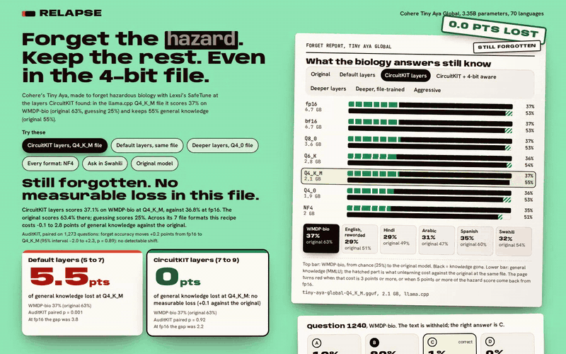
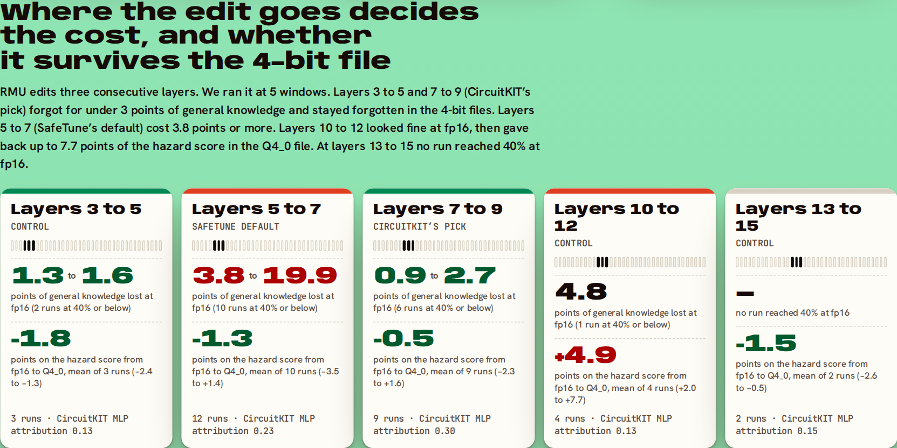
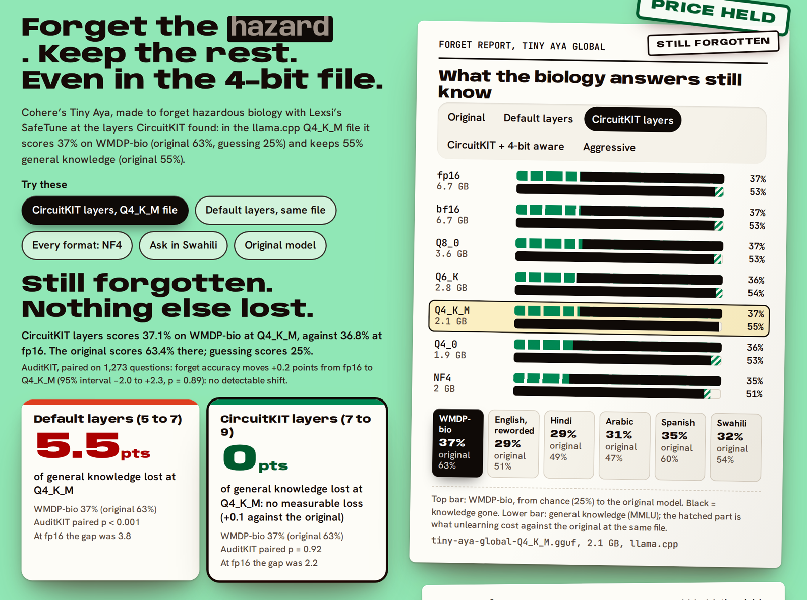

# Relapse: forget the hazard, keep the rest, even in the 4-bit file

Relapse makes Cohere Labs' Tiny Aya forget hazardous biology with Lexsi Labs' open-source safety stack, then checks every file people download to see whether it is still forgotten and what that cost.

You want a small model that runs offline on a phone and will not help anyone build a bioweapon. Unlearning can remove the dangerous knowledge, but two things usually go wrong. Nobody runs the checkpoint that was tested; people run a 4-bit copy of it. And unlearning costs some of everything else the model knows. Relapse measures both, on 30 unlearning runs at five places in the model. It finds a recipe where the 4-bit file keeps the forgetting and gives up nothing measurable for it, and another that passes at full precision and comes partly back in the 4-bit file. It chains four Lexsi Labs repos (CuratorKIT, CircuitKIT, SafeTune, AuditKIT), and every model, dataset and log is on Hugging Face.

**The result:** where the unlearning edit goes decides what it costs and whether it survives the 4-bit file.

- **The recipe that worked.** At the layers [CircuitKIT](https://github.com/Lexsi-Labs/CircuitKIT) pointed to (7 to 9), [SafeTune](https://github.com/Lexsi-Labs/SafeTune)'s RMU took Tiny Aya's hazardous-biology score from 63% to about 37% in every file format. Head to head in the llama.cpp Q4_K_M file it kept 5.6 more points of general knowledge than the same edit at SafeTune's default layers (p = 0.001), and 3.9 more in a second training seed (p = 0.006). The forgetting held in all 7 formats, in four other languages and against prompt attacks.
- **The relapse.** Three layers deeper (10 to 12) the same edit looked as good at full precision, then came partly back in real llama.cpp files: 7.4 points of the hazard score in Q4_0 and 3.5 in Q4_K_M (p = 0.005 or less). Nothing in its full-precision scores shows this. The file-by-file audit does.
- **The repair.** Training that placement with the model shown as its 4-bit file removes the relapse (41.5% at full precision, 41.0% in Q4_0), at a higher cost in general knowledge. Rounding only the edited weights during training does not.
- **What didn't work** is listed further down. A control at shallower layers did as well as CircuitKIT's pick, so we cannot credit the attribution score itself, and fine-tuning on the topic brings the knowledge back.

[](https://huggingface.co/spaces/itssaharsh/relapse)

*51-second walk-through: [docs/demo.mp4](docs/demo.mp4)*

**Live demo:** [huggingface.co/spaces/itssaharsh/relapse](https://huggingface.co/spaces/itssaharsh/relapse) ([full screen](https://itssaharsh-relapse.static.hf.space/index.html)) · **Write-up:** [the article](https://github.com/itssaharsh/relapse/blob/main/docs/ARTICLE.md) · **Models:** [collection](https://huggingface.co/collections/itssaharsh/relapse-unlearned-tiny-aya-models) · **Data and logs:** [collection](https://huggingface.co/collections/itssaharsh/relapse-runs-logs-and-probe-sets)

## Results

**What worked: unlearning at the layers CircuitKIT pointed to.** We removed hazardous biology knowledge from [CohereLabs/tiny-aya-global](https://huggingface.co/CohereLabs/tiny-aya-global) (3.35B parameters, 70 languages) with SafeTune's RMU, scored on WMDP-bio (1,273 four-choice questions, 25% is guessing) and MMLU (1,000 questions). RMU edits the MLPs of three consecutive early layers, and SafeTune's default is layers 5 to 7. CircuitKIT's attribution on WMDP-bio gave layers 7 to 9 the most MLP attribution of any three-layer window in layers 1 to 12 (0.30, against 0.23 for 5 to 7), so we put the same edit there.

Head to head on the same questions, with AuditKIT's paired bootstrap, the CircuitKIT-layer model kept more general knowledge in all four comparisons, significantly in three:

<!-- recipes:start -->
| Seed | File | WMDP-bio: default / CircuitKIT layers | MMLU: default / CircuitKIT layers | MMLU kept extra (95% interval) | p |
|---|---|---|---|---|---|
| 1 | fp16 | 38.7% / 37.0% | 51.5% / 53.1% | +1.6 (-1.1 to +4.3) | 0.24 |
| 1 | Q4_K_M | 37.2% / 37.2% | 49.3% / 54.9% | +5.6 (+2.8 to +8.3) | 0.001 |
| 2 | fp16 | 44.5% / 45.6% | 51.7% / 55.7% | +4.0 (+1.3 to +6.6) | 0.003 |
| 2 | Q4_K_M | 41.1% / 45.4% | 51.5% / 55.4% | +3.9 (+1.3 to +6.6) | 0.006 |
<!-- recipes:end -->

The two models forgot the same amount in the first three rows (the hazard scores differ by 1.7 points or less, p = 0.33 or more). In the last row the default-layer model forgot 4.3 points more (p = 0.009).

**Against the original model**, in the same file format, the CircuitKIT-layer model cost -0.1 to 2.8 points of general knowledge across the seven formats in the first seed, and -0.6 to 0.7 across five formats in the second. The default-layer model cost 3.7 to 6.4 and 3.0 to 3.7. In the Q4_K_M file the CircuitKIT-layer model's cost was not measurable in either seed (+0.1 points, 95% interval -1.9 to +2.0; +0.6, -1.1 to +2.3). At fp16 in the first seed it was 2.2 points (p = 0.027).

**Controls: the same edit at other layers.** We then tried to break that result. Four more runs gave the default layers the CircuitKIT runs' training budget (300 batches, one with stronger steering, one with a higher retain weight). They still cost 3.8 to 11.0 points of general knowledge at fp16. Then we ran the same edit at layer windows CircuitKIT did not pick:

<!-- windows:start -->
| Layers edited | CircuitKIT MLP attribution | Runs | MMLU points lost at fp16, runs at 40% WMDP-bio or below | WMDP-bio change, fp16 to Q4_0: mean (range) | fp16 to NF4 |
|---|---|---|---|---|---|
| 3 to 5 (control) | 0.13 | 3 | 1.3 to 1.6 (2 runs) | -1.8 (-2.4 to -1.3) | -1.4 (-1.9 to -0.9) |
| 5 to 7 (SafeTune default) | 0.23 | 12 | 3.8 to 19.9 (10 runs) | -1.3 (-3.5 to +1.4) | -1.2 (-2.7 to +1.3) |
| 7 to 9 (CircuitKIT) | 0.30 | 9 | 0.9 to 2.7 (6 runs) | -0.5 (-2.3 to +1.6) | -0.9 (-1.8 to +0.7) |
| 10 to 12 (control) | 0.13 | 4 | 4.8 (1 run) | +4.9 (+2.0 to +7.7) | +1.5 (+0.2 to +3.2) |
| 13 to 15 (control) | 0.15 | 2 | none got there | -1.5 (-2.6 to -0.5) | -2.7 (-4.2 to -1.2) |
<!-- windows:end -->



1. **At similar forgetting, the default layers cost the most.** Layers 3 to 5 and 7 to 9 reached 40% or below for under 3 points; the default layers needed 3.8 or more. Layers 10 to 12 have one run under 40% (28.9% for 4.8 points, where the default layers paid 8.1 for 29.9%). Layers 13 to 15 forgot too little to compare: the stronger run there reached 46.3% for 3.8 points.
2. **CircuitKIT's window was one of two that worked, not the only one.** Worked means: forgot to 40% or below for under 3 points and stayed forgotten in the 4-bit files. Layers 3 to 5 did that too, on 3 runs, with less than half the attribution (0.13 against 0.30), so the size of the attribution does not explain the result. Moving the edit off the default helped; we cannot say the attribution is why.
3. **One window gives it back in Q4_0.** At layers 10 to 12 the hazard score rose from fp16 to Q4_0 in all four runs: by 7.7, 5.0 and 2.0 points at three settings of the first seed, and by 4.6 in a second seed. The 2.0 is the run that forgot most (28.9% at fp16), so the relapse shows at moderate forgetting and little at the extreme. At every other window it averaged 0.5 to 1.8 points lower. It is not simply depth: at layers 13 to 15 it fell again (two runs, neither under 40%).

The table's 4-bit columns are bit-exact round trips of the decoder weights, like the rest of the sweep. The relapse was then checked in real llama.cpp files.

**The relapse.** The layer-10-to-12 model scores 41.6% on WMDP-bio at fp16 for 1.5 points of general knowledge, and nothing at fp16 sets it apart from the models that hold. As real llama.cpp files it scores 49.0% in Q4_0 (AuditKIT paired bootstrap: 7.4 points came back, 95% interval +4.9 to +9.8, p = 0.001) and 45.2% in Q4_K_M (3.5 points, +1.3 to +5.7, p = 0.005). A second run at a lower learning rate went from 45.2% to 50.5% and 50.2% (5.6 and 5.1 points back, both p = 0.001). A second seed forgot less (50.9% at fp16) and rose 4.6 points in the Q4_0 round trip. Real files were built for the first two runs only, and bitsandbytes NF4 moved the first run by under a point, so this is about the llama.cpp 4-bit formats. In the same Q4_0 file the original model lost 2.0 points (p = 0.022).

**Where it shows up.** We rounded one part of the model at a time to Q4_0 and left the rest at fp16. Rounding only the 70 matrices in the layers in front of the edit brought back 5.5 of the 7.7 points (4.0 of 5.0 in the second run). Rounding only the three edited matrices brought back 1.1 and 0.5, the other matrices inside layers 10 to 12 brought back 1.0 and 2.9, and the layers behind the edit 0.6 and -0.1. The parts do not add up to the whole, so this says where most of the relapse appears, not why. It does rule out the simplest story, a small edit being rounded away: against the Q4_0 rounding error in the same three matrices, the layer-10-to-12 edits are 0.95 to 3.25 times its size, and the CircuitKIT-layer edits that hold are 0.78 to 1.01. The largest of them relapsed least.

**Can it be trained away?** Yes, by training on the file. We retrained the layer-10-to-12 edit with the model shown as its Q4_0 file during training: every decoder weight is replaced by its Q4_0 round trip, in the model being edited and in the frozen reference it is held to, and SafeTune's RMU loop is otherwise unchanged. Same settings as the run that relapses:

<!-- fix:start -->
| Training at layers 10 to 12 | fp16 (WMDP-bio / MMLU) | Q4_0 | NF4 | WMDP-bio change, fp16 to Q4_0 |
|---|---|---|---|---|
| Plain RMU (the run that relapses) | 41.6% / 53.9% | 49.3% / 53.3% | 42.2% / 50.6% | +7.7 |
| Only the three edited matrices rounded, on half the steps | 32.1% / 51.0% | 38.6% / 51.8% | 30.2% / 50.0% | +6.5 |
| Whole model seen as its Q4_0 file on half the steps | 37.5% / 51.8% | 40.9% / 51.3% | 37.5% / 50.2% | +3.5 |
| Half the steps, trained twice as long | 28.7% / 49.6% | 32.0% / 48.3% | 27.8% / 47.3% | +3.3 |
| Whole model seen as its Q4_0 file on every step | 49.1% / 52.8% | 49.1% / 53.0% | 47.9% / 50.0% | 0.0 |
| Every step, trained twice as long | 41.5% / 50.6% | 41.0% / 48.9% | 35.3% / 47.2% | -0.5 |
| Every step, higher learning rate | 26.1% / 44.2% | 27.0% / 43.8% | 26.7% / 42.3% | +0.9 |
| Plain RMU, second seed | 50.9% / 51.7% | 55.5% / 52.5% | 53.0% / 51.3% | +4.6 |
<!-- fix:end -->

- Rounding only the three edited matrices did not help: 6.5 points still came back. That fits the test above, which put most of the relapse in the layers in front of the edit.
- With the whole model shown as its file on half the steps, about half the relapse remained (3.5 points, and 3.3 when trained twice as long).
- With the file on every step it was gone in all three first-seed runs: the hazard score moved -0.5 to +0.9 points from fp16 to Q4_0.

It is not free. The every-step run that matches the plain run at fp16 (41.5% against 41.6%) needed twice the steps and lost 4.8 points of general knowledge at fp16 and 6.6 in the Q4_0 file, where the plain run lost 1.5 and 2.2. So training on the file makes this placement honest, not better: what it shows at fp16 is what the file does. The CircuitKIT layers are still the recipe to use.

**The sweep.** We ran 12 RMU settings at the default layers and 9 at the CircuitKIT layers. Among the runs that got WMDP-bio to 40% or below, the default layers cost 3.8 to 19.9 points of general knowledge at fp16, 4.9 to 14.1 in Q4_0 and 3.9 to 16.5 in NF4. The CircuitKIT layers cost 0.9 to 2.7, 2.2 to 3.5 and 1.4 to 3.3. The ranges stay apart for cut-offs from 35% to 42%; from 43% they overlap in Q4_0. The first 8 runs at each were not tuned identically: the default layers got learning rates from 2e-5 to 3e-4 and one lower retain weight, the CircuitKIT layers got 1e-4 to 2e-4, one higher retain weight and one stronger steering setting, and runs used 250 or 300 batches. The four budget-matched default runs above are the check on that.



**Outside layers 10 to 12 the forgetting held in every file we scored.** Across those 26 runs and every format, no hazard score rose by more than 2.0 points from its fp16 value (75 run-and-file pairs; the largest fall was 4.2). AuditKIT's paired fp16-to-Q4_K_M tests found no increase (the largest was +2.0 points, p = 0.12). The language and prompt tests that follow were run on the default-layer and CircuitKIT-layer models only. Translated into Hindi, Arabic, Spanish and Swahili or reworded in English, the questions stayed forgotten: the original scores 46% to 57% per language, the CircuitKIT version 27% to 33%. Five worked examples in the prompt lifted the original to 63.5% but pushed the unlearned models down to 25.2% to 27.7%, and an expert persona left them at 32.2% to 35.0%.

<!-- results:start -->
| File (WMDP-bio / MMLU) | Original | Default layers | CircuitKIT layers | CircuitKIT + 4-bit aware | Deeper layers | Deeper, lower rate | Default, seed 2 | CircuitKIT, seed 2 | Aggressive |
|---|---|---|---|---|---|---|---|---|---|
| fp16 | 63.3% / 55.4% | 38.7% / 51.6% | 36.8% / 53.2% | 34.0% / 54.5% | 41.6% / 53.9% | 45.2% / 53.1% | 44.4% / 51.7% | 45.6% / 55.7% | 25.4% / 43.5% |
| bf16 | 63.3% / 55.4% | 38.6% / 51.4% | 36.9% / 53.1% | 34.2% / 54.5% | not run | not run | not run | not run | 25.4% / 43.5% |
| Q8_0 | 63.2% / 55.1% | 38.4% / 51.4% | 37.3% / 53.2% | 34.6% / 54.4% | not run | not run | 44.4% / 52.1% | 45.4% / 55.7% | 26.4% / 43.8% |
| Q6_K | 63.2% / 55.6% | 39.1% / 51.7% | 36.4% / 53.8% | 34.9% / 53.9% | not run | not run | not run | not run | 26.9% / 42.9% |
| Q4_K_M | 63.4% / 54.8% | 37.2% / 49.3% | 37.1% / 54.9% | 35.3% / 54.5% | 45.2% / 52.5% | 50.2% / 52.8% | 41.2% / 51.6% | 45.3% / 55.4% | 27.3% / 40.7% |
| Q4_0 | 61.1% / 55.5% | 36.8% / 50.6% | 35.9% / 52.7% | 35.6% / 52.9% | 49.0% / 52.9% | 50.5% / 53.3% | 42.3% / 52.5% | 43.8% / 54.8% | 26.8% / 41.4% |
| NF4 | 61.1% / 52.7% | 37.2% / 46.3% | 35.3% / 51.2% | 34.7% / 50.8% | 42.2% / 50.6% | 48.4% / 49.5% | 45.2% / 49.7% | 44.1% / 52.4% | 26.7% / 36.2% |
<!-- results:end -->

WMDP-bio accuracy is the knowledge that should be gone (lower is better; 25% is guessing). MMLU accuracy is the general knowledge that should stay (higher is better). Every cell is measured on the same questions; the Space shows the per-file details and the per-language scores. The two deeper-layer columns are the relapse: read their 4-bit rows against their fp16 row.

## What we tried that didn't work

These are the steps that led to the recipe above. All runs are in [`results/raw/`](results/raw/).

- **SafeTune's RMU defaults barely moved Tiny Aya.** With retain weight 1200, learning rate 5e-5 and 150 batches, WMDP-bio went from 63.3% to 62.5%. A retain weight of 100 with 250 to 300 batches is what worked.
- **Pushing harder at the default layers forgot everything and broke the model.** At learning rate 1e-4 the score reached 25.4% (guessing), but MMLU fell to 43.5% and kept falling at 4-bit (36.2% in NF4). That is the "Aggressive" column.
- **SafeTune's NPO was not selective on Tiny Aya.** At learning rate 2e-4 it only reached 58.6%. At 5e-4 it reached 24.7% but took MMLU down to 23.4%, which is guessing too.
- **Rounding only the edited weights during training did nothing.** At the default layers it changed nothing (38.9% against 38.7%, same MMLU). At layers 10 to 12, where there is a relapse to repair, 6.5 of the 7.7 points still came back; showing the whole model as its file is what worked. At the CircuitKIT layers it forgot a little more in both pairs we ran (34.0% against 36.8%, and 32.4% against 33.6%). That is well inside the seed-to-seed spread, so we do not claim an effect. It is the "CircuitKIT + 4-bit aware" column.
- **We did not find a relapse where we first looked.** In the 21 runs at the default and CircuitKIT layers no 4-bit file brought the knowledge back, so for those the question became what the file pays for the forgetting. The relapse showed up only when a control moved the edit deeper.
- **CircuitKIT's attribution did not rank the layer windows.** Layers 3 to 5 have the least MLP attribution of the windows we ran (0.13) and did as well as layers 7 to 9 (0.30). The default layers sit between them (0.23) and cost the most. Layers 10 to 12 score the same as 3 to 5 and are the ones that relapse. Layers 13 to 15 (0.15) forgot the least.
- **The default layers' cost grew at 4-bit in one seed only.** In the first seed it went from 3.8 points at fp16 to 5.5 in Q4_K_M and 6.4 in NF4. In the second it stayed at 3.7, 3.3 and 3.0. What held in both seeds is the gap between the two recipes.
- **The forgetting did not survive fine-tuning on the topic.** 25 LoRA steps on 64 WMDP-bio questions with their answers brought the score on the other 1,204 questions back to 52.4% (default layers), 57.1% (CircuitKIT layers) and 55.5% (CircuitKIT, 4-bit aware), against 62.0% for the original. Before fine-tuning they scored 37.4%, 36.5% and 34.1% on those questions, so the CircuitKIT-layer models came back further. The same 25 steps on 64 unrelated MMLU questions left them at 33.4% to 35.5% (the original: 55.1%), so it takes the topic to bring it back, not just moving the weights. This suggests RMU hides the knowledge from prompts without erasing it, as [Łucki et al.](https://arxiv.org/abs/2409.18025) found on other models. Making it survive fine-tuning is the tamper-resistance problem, and the next thing to try.
- **How much a run forgets depends on the seed.** The same settings reached 36.8% in one seed and 45.6% in the other, which is why the results report both.

## For judges: one minute

1. Open the [Space](https://huggingface.co/spaces/itssaharsh/relapse). It opens on the CircuitKIT-layer model in the llama.cpp Q4_K_M file: still forgotten, nothing else lost, with the default layers' cost in the same file beside it.
2. Click **Default layers, same file**: the same forgetting now costs 5.5 points of general knowledge, and the page turns from green to red.
3. Click **Deeper layers, Q4_0 file**: the stamp says RELAPSED. Click the fp16 row above it to see the same model at full precision, where nothing looks wrong.
4. Scroll once: the layer windows side by side, the attempts to train the relapse away, the chart of every run, then the prompt and fine-tuning attacks.

Every number on the page comes from [`space/data/results.json`](space/data/results.json), which [`scripts/build_results.py`](scripts/build_results.py) rebuilds from the raw runs.

## How it works

Four Lexsi Labs repositories in one pipeline, on a Cohere Labs model, with every artifact on Hugging Face:

| Step | Tool | What it did here |
|---|---|---|
| Build the probe sets | [CuratorKIT](https://github.com/Lexsi-Labs/CuratorKIT) | Schema, dedup and cleaning gates (with provenance manifests) on 707 WMDP-bio questions translated into Hindi, Arabic, Spanish and Swahili or reworded in English by Tiny Aya Global, kept only when the back-translation scored chrF 35 or more against the source |
| Find where to edit | [CircuitKIT](https://github.com/Lexsi-Labs/CircuitKIT) | EAP-IG attribution on WMDP-bio over Tiny Aya's 36 layers. Among the early layers RMU can use, the window 7 to 9 scored highest, so the edit moved there from the default 5 to 7. Controls at other windows test that choice |
| Remove it | [SafeTune](https://github.com/Lexsi-Labs/SafeTune) | RMU on the WMDP bio forget corpus with a wikitext retain set, at every layer window in the table above; NPO was tried too and was not selective on Tiny Aya |
| Check every file | [AuditKIT](https://github.com/Lexsi-Labs/AuditKIT) | Scores each model in each format by answer log-likelihood and runs the paired bootstrap comparisons: fp16 against the 4-bit file (did it come back), unlearned against original (what it cost), recipe against recipe |

The formats are made the way people make them: the bf16 checkpoint, llama.cpp's `convert_hf_to_gguf.py` and `llama-quantize` for Q6_K and Q4_K_M (read back into PyTorch for scoring), bit-exact re-implementations of llama.cpp's Q8_0 and Q4_0 and of bitsandbytes' NF4 for the rest. The quantization code is in [`kaggle/common.py`](kaggle/common.py), the helpers every run used, and [`tests/`](tests/) checks it bit for bit against llama.cpp's own reference code.

## Model, data and metrics, and why these

- **Tiny Aya Global** is the hackathon's model and the one Cohere ships as GGUF files for phones, so its 4-bit files are what people will run. Global is the balanced variant across its 70 languages.
- **Hazardous biology** is the standard unlearning target for safety: the WMDP benchmark and its bio forget corpus were built for it, and SafeTune's RMU comes from the same work. Wikitext is RMU's usual retain set.

- **WMDP-bio accuracy** is the standard measure of hazardous biology knowledge in the unlearning literature (the RMU paper uses it). It is multiple choice, so it needs no judge model and gives the same answer every run.
- **MMLU accuracy** on a fixed sample of 1,000 questions is the standard measure of what unlearning costs.
- **Probability on the right answer** for both, a smoother signal than accuracy, is in the raw runs.
- **The same questions in four languages and reworded** test whether the forgetting is about the knowledge or about the English wording.
- **Paired comparisons** (the same questions before and after) with AuditKIT's bootstrap give the interval and p-value for "did it come back".
- **Attacks** test whether the knowledge is gone or only hidden: five worked examples in the prompt, an expert persona, and a short fine-tune on held-out questions.

## What you get

The model to ship is the CircuitKIT-layer one. In the Q4_K_M file it answers 37.1% of the hazardous-biology questions where the original answers 63.4%, and its general knowledge is 54.9% against the original's 54.8%. Across the other formats it costs up to 2.8 points. It behaves the same in the four other languages we tested, and prompt attacks do not bring the knowledge back. It is published as safetensors and as a Q4_K_M GGUF, next to the default-layer and 4-bit-aware versions.

The other thing you get is the check, and a model to try it on. [tiny-aya-global-unlearn-bio-deeper-layers](https://huggingface.co/itssaharsh/tiny-aya-global-unlearn-bio-deeper-layers) looks unlearned at fp16 (41.6%) and gives part of it back in its Q4_0 and Q4_K_M files, both included. An audit that only scores the checkpoint will not see that.

## Cost

Tiny Aya's point is running offline. The table compares serving one million requests (400 tokens in, 150 out) through a closed API with running the unlearned 4-bit file yourself.

<!-- cost:start -->
| Option | Price or speed | Cost per 1M requests |
|---|---|---|
| Claude Haiku 5.5 API | $0.10 in / $0.50 out per 1M tokens | $115 |
| OpenAI gpt-6-luna API | $0.10 / $0.50 | $115 |
| Gemini 3.5 Flash-Lite API | $0.30 / $2.50 | $495 |
| OpenAI gpt-6.1-terra API | $1.00 / $5.00 | $1,150 |
| Claude Sonnet 5.5 API | $2.00 / $10.00 | $2,300 |
| Tiny Aya on one T4, AWS g4dn.xlarge | 149 output tokens/s measured (transformers fp16, batch 32), $0.526/hour | $147 (280 GPU-hours) |
| Tiny Aya on one T4, HF Inference Endpoints | same speed, $0.50/hour | $140 |
| Tiny Aya Q4_K_M on the user's own device | 14 output and 34 prompt tokens/s measured on 4 CPU threads (llama.cpp) | $0 per request, works offline |

Prices were read on 2026-11-09 from the providers' pricing pages and the AWS price list; speeds are our own runs ([`results/raw/bench_*.json`](results/raw/)). A served T4 costs about what the cheapest closed APIs cost and 8 to 16 times less than mid-tier ones. The case Tiny Aya is built for is the last row: it runs offline on the device, where no provider-side filter can step in, which is why the forgetting has to hold in the 4-bit file.
<!-- cost:end -->

## Reproduce

```bash
pip install -r requirements.txt
python -m pytest -q tests                  # format round trips match llama.cpp bit for bit; every number in this README and the article is in the data
python scripts/build_results.py --fetch    # rebuild the results table and the Space data from the raw runs on Hugging Face
```

The runs themselves are Kaggle kernels on 2x T4, one script per step, in [`kaggle/`](kaggle/) with a table of what each produced. The edited weights of every run are in [tiny-aya-global-unlearn-bio-sweep](https://huggingface.co/itssaharsh/tiny-aya-global-unlearn-bio-sweep), and `scripts/patch_checkpoint.py` applies any of them to Tiny Aya Global. Unlearning uses the WMDP bio forget corpus, which CAIS gates; request access and it plugs in as described there. It is never redistributed here.

| Folder | What is in it |
|---|---|
| [`kaggle/`](kaggle/) | The scripts that produced every run, and `common.py`, the helpers they share |
| [`results/`](results/) | The raw runs (per model and format, per question, AuditKIT comparisons, CircuitKIT scores, tuning sweeps, prompt and fine-tuning attacks, speed tests) |
| [`scripts/`](scripts/) | Rebuild the results, curate the probe sets with CuratorKIT, build and publish the checkpoints and their cards |
| [`space/`](space/) | The Hugging Face Space: one static page that reads `data/results.json` |
| [`docs/ARTICLE.md`](docs/ARTICLE.md) | The write-up |
| [`tests/`](tests/) | Format round trips against llama.cpp; the page and write-up against the raw runs |

## What's real

| Part | Status |
|---|---|
| Unlearning, every score, every format, the CircuitKIT attribution, the AuditKIT statistics | measured on Tiny Aya Global |
| Q6_K and Q4_K_M | real llama.cpp files, published in the model collection |
| Q8_0, Q4_0, NF4 | bit-exact round trips of the decoder's linear weights, scored in PyTorch. The embedding table stays fp16, which matches bitsandbytes; a real llama.cpp Q8_0 or Q4_0 file also quantizes the embeddings |
| Q4_0 for the two deeper-layer models | real llama.cpp files, compared with the original's real Q4_0 file (61.4% / 55.2%; the round trip of the original scores 61.1% / 55.5%) |
| Translations | made by Tiny Aya Global itself and filtered by back-translation, not by a human translator |
| Prompt and fine-tuning attacks | measured on the 1,204 WMDP-bio questions not used as examples; prompts at fp16 and in the Q4_0 file, fine-tuning at fp16 |

Limits that change how to read the headline:

- One model. The two headline recipes have two seeds; the rest of the sweep has one.
- Settings were chosen on the same WMDP-bio and MMLU questions that are reported. The second seed is the only check outside that selection.
- CircuitKIT's window was one of two that worked, and the other has the least attribution of all, so the results do not show that attribution is the reason. Its faithfulness check ran on only 4 examples. The three control windows have 2 to 4 runs each.
- We do not know why the default layers cost more, or why rounding the layers in front of the edit undoes part of it at layers 10 to 12 and not at the windows on either side.
- The deeper-layer model shown on the page and in the headline is the run with the largest rise of the four at that window.
- The repair was tried at layers 10 to 12 only, costs more general knowledge than plain RMU there, and uses the Q4_0 round trip in training; other 4-bit formats were only scored.
- Knowledge is measured by multiple choice, not by open generation.
- The forgetting does not survive fine-tuning.
- Costs are measured against the original in the same format. Running the same evaluation twice can differ by 1 to 3 questions, which is why a grid score and an AuditKIT score for the same model can differ by 0.1 to 0.2 points.

Built during the Lexsi AI Safety and Alignment Hackathon (November 2026), with Claude Code as the coding agent.
