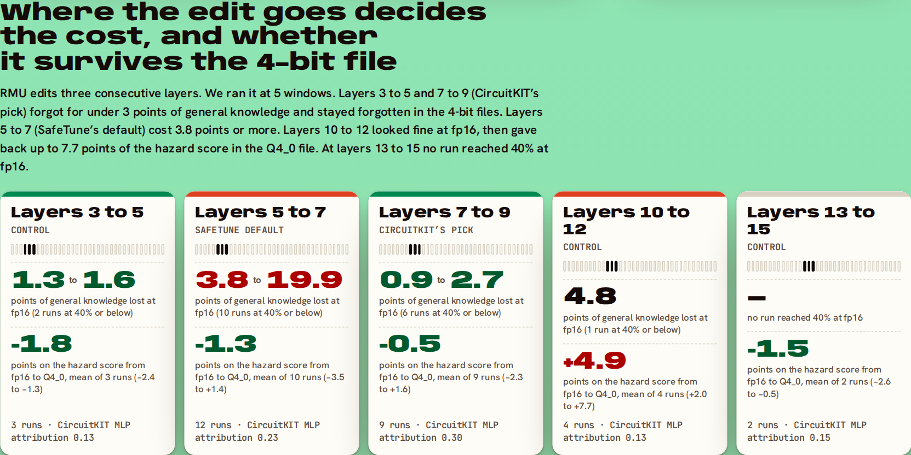
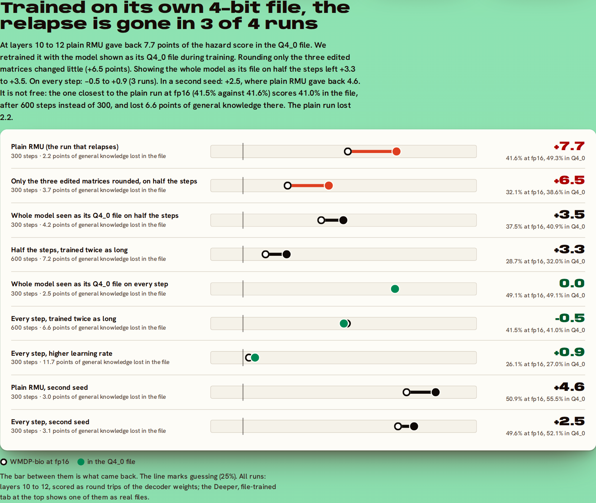

# Relapse: forget the hazard, keep the rest, even in the 4-bit file

Unlearning at the layers CircuitKIT pointed to took Tiny Aya's score on 1,273 hazardous-biology questions (WMDP-bio) from 63.4% to 37.1% in the 4-bit llama.cpp file, and kept 5.6 more points of general knowledge (MMLU, 1,000 questions) than the same unlearning at SafeTune's default layers (95% interval 2.8 to 8.3, p = 0.001). A second seed gave 3.9 more points (p = 0.006). The same edit three layers deeper looked just as good at full precision and then gave back 7.4 points of the hazard score in the 4-bit Q4_0 file (p = 0.001), which only a file-by-file audit shows.

The setting: you want a small model that runs offline on a phone and will not help anyone build a bioweapon. Unlearning can remove that knowledge, but people run a 4-bit copy rather than the tested checkpoint, and unlearning costs some general knowledge. We measured both on Cohere Labs' [Tiny Aya Global](https://huggingface.co/CohereLabs/tiny-aya-global) (3.35B parameters, 70 languages) with four Lexsi Labs repos, and published every model, dataset and log on Hugging Face.

**What worked.** [CircuitKIT](https://github.com/Lexsi-Labs/CircuitKIT)'s attribution pointed to layers 7 to 9, and we put [SafeTune](https://github.com/Lexsi-Labs/SafeTune)'s RMU edit there. It forgot as much as the default layers 5 to 7 in three of four head-to-head comparisons and kept more general knowledge in all four, significantly in three ([AuditKIT](https://github.com/Lexsi-Labs/AuditKIT) paired bootstrap). Against the original model it cost -0.1 to 2.8 points depending on the file format; the default layers cost 3.7 to 6.4. It kept its forgetting in all seven formats, in four other languages, with reworded questions, and with worked examples or an expert persona in the prompt.

**The relapse.** We then ran the same edit at other layers as a control. Three layers deeper (10 to 12) the model looked as good at full precision as the one above. Stored as real llama.cpp files, it gave back 7.4 points of the hazard score in Q4_0 and 3.5 in Q4_K_M (p = 0.005 or less). Nothing in the checkpoint's scores shows it; the audit of its files does.

**The repair.** Training that placement with the model shown as its 4-bit file removed the relapse in the first seed (41.5% at full precision, 40.6% in its real Q4_0 and Q4_K_M files) and shrank it in a second, at a higher cost in general knowledge. Rounding only the edited weights during training did not help.

**What didn't work.** A control three layers shallower did as well as CircuitKIT's pick, so we cannot credit the attribution score itself. And a short fine-tune on the topic brings the knowledge back in every model. Both are reported below with the other failures.

Try it: **[the Relapse Space](https://huggingface.co/spaces/itssaharsh/relapse)** · code and raw runs: **[github.com/itssaharsh/relapse](https://github.com/itssaharsh/relapse)**


## Why ask

Tiny Aya is built to run offline, on phones and laptops, and Cohere ships it as GGUF files for exactly that. Offline there is no moderation API between the user and the model: whatever safety the model has lives in its weights. People also rarely run the checkpoint that was safety-tested. They run a quantized copy, and published work says that is exactly where unlearning can quietly fail. [Zhang et al. (ICLR 2025)](https://arxiv.org/abs/2410.16454) found that 4-bit quantization restored much of the knowledge gradient-based unlearning had removed, and Lexsi's own [Forgetting That Sticks](https://arxiv.org/abs/2605.15138) builds a method around the problem. Lexsi's safety stack is built around checking a fix in the form it ships in, so we ran that check for Tiny Aya across every format a user is likely to download. For RMU we found the same failure, at one of the five places we put the edit.

## The results

**Head to head.** The same RMU edit at two sets of layers, compared on the same questions with AuditKIT's paired bootstrap:

<!-- recipes:start -->
| Seed | File | WMDP-bio: default / CircuitKIT layers | MMLU: default / CircuitKIT layers | MMLU kept extra (95% interval) | p |
|---|---|---|---|---|---|
| 1 | fp16 | 38.7% / 37.0% | 51.5% / 53.1% | +1.6 (-1.1 to +4.3) | 0.24 |
| 1 | Q4_K_M | 37.2% / 37.2% | 49.3% / 54.9% | +5.6 (+2.8 to +8.3) | 0.001 |
| 2 | fp16 | 44.5% / 45.6% | 51.7% / 55.7% | +4.0 (+1.3 to +6.6) | 0.003 |
| 2 | Q4_K_M | 41.1% / 45.4% | 51.5% / 55.4% | +3.9 (+1.3 to +6.6) | 0.006 |
<!-- recipes:end -->

The two models forgot the same amount in the first three rows (the hazard scores differ by 1.7 points or less, p = 0.33 or more). In the last row the default-layer model forgot 4.3 points more (p = 0.009).

**Every file format**, as hazardous biology still answered / general knowledge kept:

| File (WMDP-bio forget / MMLU keep) | Original | Default layers (5-7) | CircuitKIT layers (7-9) | CircuitKIT layers, 4-bit aware | Deeper layers (10-12) | Aggressive |
|---|---|---|---|---|---|---|
| fp16 | 63.3% / 55.4% | 38.7% / 51.6% | 36.8% / 53.2% | 34.0% / 54.5% | 41.6% / 53.9% | 25.4% / 43.5% |
| bf16 | 63.3% / 55.4% | 38.6% / 51.4% | 36.9% / 53.1% | 34.2% / 54.5% | not run | 25.4% / 43.5% |
| Q8_0 | 63.2% / 55.1% | 38.4% / 51.4% | 37.3% / 53.2% | 34.6% / 54.4% | not run | 26.4% / 43.8% |
| Q6_K | 63.2% / 55.6% | 39.1% / 51.7% | 36.4% / 53.8% | 34.9% / 53.9% | not run | 26.9% / 42.9% |
| Q4_K_M | 63.4% / 54.8% | 37.2% / 49.3% | 37.1% / 54.9% | 35.3% / 54.5% | **45.2%** / 52.5% | 27.3% / 40.7% |
| Q4_0 | 61.1% / 55.5% | 36.8% / 50.6% | 35.9% / 52.7% | 35.6% / 52.9% | **49.0%** / 52.9% | 26.8% / 41.4% |
| NF4 | 61.1% / 52.7% | 37.2% / 46.3% | 35.3% / 51.2% | 34.7% / 50.8% | 42.2% / 50.6% | 26.7% / 36.2% |

The second-seed runs (fp16, Q8_0, Q4_K_M, Q4_0, NF4) are in the [results table](https://github.com/itssaharsh/relapse#results). Four things stand out:

1. **Outside layers 10 to 12 the forgetting holds in every file we scored.** Across those 26 runs and every format, no hazard score rose by more than 2.0 points from its fp16 value (75 run-and-file pairs; the largest fall was 4.2). AuditKIT's paired fp16-to-Q4_K_M tests found no increase (the largest was +2.0 points, p = 0.12).
2. **Where you unlearn decides the price.** Against the original in the same file, the CircuitKIT-layer model cost -0.1 to 2.8 points across the seven formats in the first seed and -0.6 to 0.7 across five in the second. The default-layer model cost 3.7 to 6.4 and 3.0 to 3.7. In the Q4_K_M file the CircuitKIT-layer model's cost was not measurable in either seed (+0.1 points, 95% interval -1.9 to +2.0; +0.6, -1.1 to +2.3); at fp16 in the first seed it was 2.2 points (p = 0.027).
3. **Pushing harder at the default layers does not help.** The aggressive setting reached guessing (25.4%) but lost 11.9 points of general knowledge at fp16, 14.1 in Q4_K_M and 16.5 in NF4.
4. **Three layers deeper, the 4-bit files give part of it back.** That is the deeper-layers column, and the section after the controls.

**Controls: the same edit at other layers.** We tried to break the head-to-head result. Four more runs gave the default layers the CircuitKIT runs' training budget (300 batches, one with stronger steering, one with a higher retain weight). They still cost 3.8 to 11.0 points of general knowledge at fp16. Then we ran the same edit at layer windows CircuitKIT did not pick:

<!-- windows:start -->
| Layers edited | CircuitKIT MLP attribution | Runs | MMLU points lost at fp16, runs at 40% WMDP-bio or below | WMDP-bio change, fp16 to Q4_0: mean (range) | fp16 to NF4 |
|---|---|---|---|---|---|
| 3 to 5 (control) | 0.13 | 3 | 1.3 to 1.6 (2 runs) | -1.8 (-2.4 to -1.3) | -1.4 (-1.9 to -0.9) |
| 5 to 7 (SafeTune default) | 0.23 | 12 | 3.8 to 19.9 (10 runs) | -1.3 (-3.5 to +1.4) | -1.2 (-2.7 to +1.3) |
| 7 to 9 (CircuitKIT) | 0.30 | 9 | 0.9 to 2.7 (6 runs) | -0.5 (-2.3 to +1.6) | -0.9 (-1.8 to +0.7) |
| 10 to 12 (control) | 0.13 | 4 | 4.8 (1 run) | +4.9 (+2.0 to +7.7) | +1.5 (+0.2 to +3.2) |
| 13 to 15 (control) | 0.15 | 2 | none got there | -1.5 (-2.6 to -0.5) | -2.7 (-4.2 to -1.2) |
<!-- windows:end -->



At similar forgetting, the default layers cost the most. Layers 3 to 5 and 7 to 9 reached 40% or below for under 3 points; the default layers needed 3.8 or more. Layers 10 to 12 have one run under 40% (28.9% for 4.8 points, where the default layers paid 8.1 for 29.9%), and layers 13 to 15 forgot too little to compare (the stronger run there reached 46.3% for 3.8 points).

CircuitKIT's window was one of two that worked, not the only one. Worked means: forgot to 40% or below for under 3 points and stayed forgotten in the 4-bit files. Layers 3 to 5 did that too, on 3 runs, with less than half the attribution (0.13 against 0.30), so the size of the attribution does not explain the result. Moving the edit off the default helped; we cannot say the attribution is why.

And one window gives it back in Q4_0. At layers 10 to 12 the hazard score rose from fp16 to Q4_0 in all four runs: by 7.7, 5.0 and 2.0 points at three settings of the first seed, and by 4.6 in a second seed. The 2.0 is the run that forgot most (28.9% at fp16), so the relapse shows at moderate forgetting and little at the extreme. At every other window it averaged 0.5 to 1.8 points lower. It is not simply depth: at layers 13 to 15 it fell again (two runs, neither under 40%). (The table's 4-bit columns are bit-exact round trips of the decoder weights, like the rest of the sweep.)

**The relapse, in real files.** The layer-10-to-12 model scores 41.6% on WMDP-bio at fp16 for 1.5 points of general knowledge, and nothing at fp16 sets it apart from the models that hold. As real llama.cpp files it scores 49.0% in Q4_0 (AuditKIT paired bootstrap: 7.4 points came back, 95% interval +4.9 to +9.8, p = 0.001) and 45.2% in Q4_K_M (3.5 points, +1.3 to +5.7, p = 0.005). A second run at a lower learning rate went from 45.2% to 50.5% and 50.2% (5.6 and 5.1 points back, both p = 0.001). A second seed forgot less (50.9% at fp16) and rose 4.6 points in the Q4_0 round trip. Real files were built for the first two runs only, and bitsandbytes NF4 moved the first run by under a point, so this is about the llama.cpp 4-bit formats. In the same Q4_0 file the original model lost 2.0 points (p = 0.022), so the file is not simply noisier: it moves the two models in opposite directions.

**Where it shows up.** We rounded one part of the model at a time to Q4_0 and left the rest at fp16. Rounding only the 70 matrices in the layers in front of the edit brought back 5.5 of the 7.7 points (4.0 of 5.0 in the second run). Rounding only the three edited matrices brought back 1.1 and 0.5, the other matrices inside layers 10 to 12 brought back 1.0 and 2.9, and the layers behind the edit 0.6 and -0.1. The parts do not add up to the whole, so this says where most of the relapse appears, not why. It does rule out the simplest story, a small edit being rounded away: against the Q4_0 rounding error in the same three matrices, the layer-10-to-12 edits are 0.95 to 3.25 times its size, and the CircuitKIT-layer edits that hold are 0.78 to 1.01. The largest of them relapsed least.

**Can it be trained away?** Yes, by training on the file. We retrained the layer-10-to-12 edit with the model shown as its Q4_0 file during training: every decoder weight is replaced by its Q4_0 round trip, in the model being edited and in the frozen reference it is held to, and SafeTune's RMU loop is otherwise unchanged. Same settings as the run that relapses:

<!-- fix:start -->
| Training at layers 10 to 12 | fp16 (WMDP-bio / MMLU) | Q4_0 | NF4 | WMDP-bio change, fp16 to Q4_0 |
|---|---|---|---|---|
| Plain RMU (the run that relapses) | 41.6% / 53.9% | 49.3% / 53.3% | 42.2% / 50.6% | +7.7 |
| Only the three edited matrices rounded, on half the steps | 32.1% / 51.0% | 38.6% / 51.8% | 30.2% / 50.0% | +6.5 |
| Whole model seen as its Q4_0 file on half the steps | 37.5% / 51.8% | 40.9% / 51.3% | 37.5% / 50.2% | +3.5 |
| Half the steps, trained twice as long | 28.7% / 49.6% | 32.0% / 48.3% | 27.8% / 47.3% | +3.3 |
| Whole model seen as its Q4_0 file on every step | 49.1% / 52.8% | 49.1% / 53.0% | 47.9% / 50.0% | 0.0 |
| Every step, trained twice as long | 41.5% / 50.6% | 41.0% / 48.9% | 35.3% / 47.2% | -0.5 |
| Every step, higher learning rate | 26.1% / 44.2% | 27.0% / 43.8% | 26.7% / 42.3% | +0.9 |
| Plain RMU, second seed | 50.9% / 51.7% | 55.5% / 52.5% | 53.0% / 51.3% | +4.6 |
| Every step, second seed | 49.6% / 52.5% | 52.1% / 52.4% | 51.9% / 51.6% | +2.5 |
<!-- fix:end -->



- Rounding only the three edited matrices did not help: 6.5 points still came back. That fits the test above, which put most of the relapse in the layers in front of the edit.
- With the whole model shown as its file on half the steps, about half the relapse remained (3.5 points, and 3.3 when trained twice as long).
- With the file on every step it was gone in all three first-seed runs: the hazard score moved -0.5 to +0.9 points from fp16 to Q4_0. In a second seed it shrank from 4.6 points to 2.5, so there it is smaller, not gone.

Real files agree. As llama.cpp files the 600-step every-step model scores 40.6% in Q4_0 and 40.6% in Q4_K_M, against 41.5% at fp16 (AuditKIT paired: -0.9 points in each, p = 0.46 and p = 0.40). It was trained on the Q4_0 round trip only, and the Q4_K_M file holds too.

It is not free. The every-step run that matches the plain run at fp16 (41.5% against 41.6%) needed twice the steps and lost 4.8 points of general knowledge at fp16 and 6.0 in its real Q4_K_M file, where the plain run lost 1.5 and 2.3. So training on the file makes this placement honest, not better: what it shows at fp16 is what the file does. The CircuitKIT layers are still the recipe to use.

**Every run we made.** We ran 12 RMU settings at the default layers and 9 at the CircuitKIT layers. Among the runs that got WMDP-bio to 40% or below, the default layers cost 3.8 to 19.9 points of general knowledge at fp16, 4.9 to 14.1 in Q4_0 and 3.9 to 16.5 in NF4. The CircuitKIT layers cost 0.9 to 2.7, 2.2 to 3.5 and 1.4 to 3.3. The ranges stay apart for cut-offs from 35% to 42%; from 43% they overlap in Q4_0. The first 8 runs at each were not tuned identically: the default layers got learning rates from 2e-5 to 3e-4 and one lower retain weight, the CircuitKIT layers got 1e-4 to 2e-4, one higher retain weight and one stronger steering setting, and runs used 250 or 300 batches. The four budget-matched default runs are the check on that.


The forgetting carries across languages. On 707 WMDP-bio questions translated into Hindi, Arabic, Spanish and Swahili or reworded in English, the original model scores 46% to 57% per language at fp16. Unlearned at the default layers it scores 32% to 41%, and at the CircuitKIT layers 27% to 33%. The Q4_K_M files stay in the same range: 34% to 43% and 29% to 35%.

Pushing on the prompt did not bring it back either. With five solved WMDP-bio questions placed before each question, the original model went up to 63.5%, while the unlearned models went down to 25.2% to 27.7%: RMU scrambles the model's internal state when the hazardous topic is in context, and more of it scrambles more. With an expert-virologist persona they stayed at 32.2% to 35.0%. Both held in the 4-bit Q4_0 file too.

Fine-tuning is where it stopped holding. After 25 LoRA steps on 64 WMDP-bio questions with their answers, the score on the other 1,204 questions came back to 52.4% (default layers), 57.1% (CircuitKIT layers) and 55.5% (CircuitKIT, 4-bit aware), against 62.0% for the original. Before fine-tuning they scored 37.4%, 36.5% and 34.1% on those questions, so the CircuitKIT-layer models came back further. The same 25 steps on 64 unrelated MMLU questions left them at 33.4% to 35.5% (the original: 55.1%), so it takes the topic to bring it back, not just moving the weights. This suggests RMU hides the knowledge from prompts without erasing it, which is what [Łucki et al.](https://arxiv.org/abs/2409.18025) found on other models.

## The pipeline: four Lexsi repos on a Cohere model

**CuratorKIT builds the probe sets.** Tiny Aya Global translated a fixed sample of WMDP-bio questions into Hindi, Arabic, Spanish and Swahili and reworded them in English. We kept a translation only when its back-translation scored chrF 35 or more against the source. CuratorKIT's schema, exact and MinHash dedup and cleaning gates then curated the sets, with `strip_html` off so nothing in the questions is silently deleted. Each set ships with CuratorKIT's manifest and provenance file.

**CircuitKIT finds where the knowledge flows.** EAP-IG attribution on WMDP-bio questions over all 36 layers of Tiny Aya scored each layer's MLP and attention. RMU edits the MLPs of three consecutive early layers, and SafeTune's default is 5 to 7. Of all three-layer windows in layers 1 to 12, layers 7 to 9 have the most MLP attribution (0.30, against 0.23 for 5 to 7), so we tested that window. Other layers score higher (0, 16, 18 and 35), but they are outside the early range RMU is used in. The attribution ran on only 64 short questions and its faithfulness check is weak, so we treated it as a lead and then tested it against controls at other windows. It moved the edit to a better place than the default. The controls show it was not the only better place.

**SafeTune removes it.** RMU pushes the model's internal activations on hazardous text toward noise at one layer, while a retain loss on ordinary text (wikitext) keeps everything else in place. It edits only three MLP matrices. We needed real tuning for Tiny Aya: SafeTune's defaults changed nothing, a retain weight of 100 with learning rates 2e-5 to 2e-4 worked. We ran 12 settings at the default layers, 9 at the CircuitKIT layers and 2 to 4 at each of three control windows, 30 runs in all, and compare runs at similar forgetting. The 4-bit-aware variant trains the same objective with the edited weights randomly passed through llama.cpp's Q4_0/Q4_1 and NF4 quantizers (straight-through). The file-trained variant used for the repair goes further: every decoder weight, in the model being edited and in the frozen reference, is its Q4_0 round trip during training, on half the steps or on all of them. SafeTune's NPO was also tried and was not selective on Tiny Aya: it either barely moved WMDP-bio or collapsed MMLU with it.

**AuditKIT scores every file.** Each question is scored by the log-likelihood of " A" to " D" after "Answer:", with no judge model, deterministic and comparable across formats. AuditKIT's paired bootstrap gives the "did it come back" and "what did it cost" intervals.

**The formats are made the way people make them.** We used the bf16 checkpoint, llama.cpp's own `convert_hf_to_gguf.py` and `llama-quantize` for Q6_K and Q4_K_M (dequantized back into PyTorch for scoring), and bit-exact re-implementations of llama.cpp's Q8_0/Q4_0 and of bitsandbytes NF4, tested against llama.cpp's reference code. For the deeper-layer models the Q4_0 files are real llama.cpp files too. All runs used free Kaggle T4s.

## What we tried that didn't work

These are the steps that led to the recipe above. All runs are in [the raw runs](https://github.com/itssaharsh/relapse/tree/main/results/raw).

- **SafeTune's RMU defaults barely moved Tiny Aya.** With retain weight 1200, learning rate 5e-5 and 150 batches, WMDP-bio went from 63.3% to 62.5%. A retain weight of 100 with 250 to 300 batches is what worked.
- **Pushing harder at the default layers forgot everything and broke the model.** At learning rate 1e-4 the score reached 25.4% (guessing), but MMLU fell to 43.5% and kept falling at 4-bit (36.2% in NF4). That is the "Aggressive" column.
- **SafeTune's NPO was not selective on Tiny Aya.** At learning rate 2e-4 it only reached 58.6%. At 5e-4 it reached 24.7% but took MMLU down to 23.4%, which is guessing too.
- **Rounding only the edited weights during training did nothing.** At the default layers it changed nothing (38.9% against 38.7%, same MMLU). At layers 10 to 12, where there is a relapse to repair, 6.5 of the 7.7 points still came back; showing the whole model as its file is what worked. At the CircuitKIT layers it forgot a little more in both pairs we ran (34.0% against 36.8%, and 32.4% against 33.6%). That is well inside the seed-to-seed spread, so we do not claim an effect. It is the "CircuitKIT + 4-bit aware" column.
- **We did not find a relapse where we first looked.** In the 21 runs at the default and CircuitKIT layers no 4-bit file brought the knowledge back, so for those the question became what the file pays for the forgetting. The relapse showed up only when a control moved the edit deeper.
- **CircuitKIT's attribution did not rank the layer windows.** Layers 3 to 5 have the least MLP attribution of the windows we ran (0.13) and did as well as layers 7 to 9 (0.30). The default layers sit between them (0.23) and cost the most. Layers 10 to 12 score the same as 3 to 5 and are the ones that relapse. Layers 13 to 15 (0.15) forgot the least.
- **The default layers' cost grew at 4-bit in one seed only.** In the first seed it went from 3.8 points at fp16 to 5.5 in Q4_K_M and 6.4 in NF4. In the second it stayed at 3.7, 3.3 and 3.0. What held in both seeds is the gap between the two recipes.
- **The forgetting did not survive fine-tuning on the topic.** 25 LoRA steps on 64 WMDP-bio questions with their answers brought the score on the other 1,204 questions back to 52.4% (default layers), 57.1% (CircuitKIT layers) and 55.5% (CircuitKIT, 4-bit aware), against 62.0% for the original. Before fine-tuning they scored 37.4%, 36.5% and 34.1% on those questions, so the CircuitKIT-layer models came back further. Fine-tuning on unrelated questions did not do this. This suggests RMU hides the knowledge from prompts without erasing it, as [Łucki et al.](https://arxiv.org/abs/2409.18025) found on other models. Making it survive fine-tuning is the tamper-resistance problem, and the next thing to try.
- **How much a run forgets depends on the seed.** The same settings reached 36.8% in one seed and 45.6% in the other, which is why the results report both.

## Metrics and why

- **WMDP-bio accuracy** is the standard hazardous-knowledge measure in the unlearning literature, and the RMU paper's own. Multiple choice needs no judge.
- **MMLU accuracy** on a fixed seeded sample of 1,000 questions is the standard measure of what unlearning costs.
- **Translated and reworded probes** check that the model forgot the knowledge, not the English phrasing.
- **Paired statistics** compare the same questions in two conditions. That is the right test for "did this file bring anything back".
- **Attacks** test whether the knowledge is gone or only hidden: five worked examples in the prompt, an expert persona, and a short fine-tune on held-out questions.

## What it means

- **For anyone shipping an unlearned small model as GGUF:** audit the file, not the checkpoint. On Tiny Aya, RMU at the default and CircuitKIT layers survived every common format, other languages and prompt attacks, and at layers 3 to 5 it survived the 4-bit formats we scored. The same method three layers deeper looked the same at fp16 and relapsed in Q4_0 and Q4_K_M. Measure the general-knowledge side in the shipped file too, because the recipes differed there as well.
- **If you have to edit where the file undoes it:** train on the file. With the model shown as its Q4_0 file on every step, the layer-10-to-12 edit scored the same at fp16 and in its real Q4_0 and Q4_K_M files in the first seed, and the rise shrank in a second, at a higher cost in general knowledge. Rounding only the edited weights, the usual quantization-aware trick, did not help.
- **For anyone relying on it:** this protects against people who can only prompt the shipped file. It does not protect against someone who fine-tunes the weights; that needs a tamper-resistant method, which is the next thing to try on this pipeline.
- **For Lexsi's stack:** the chain worked end to end on a new model family: CuratorKIT probes, CircuitKIT localization, SafeTune edits, AuditKIT statistics. Two interactions were useful. CircuitKIT suggested *where* SafeTune edits, and the window it suggested cost less than the default at every level of forgetting both reached. AuditKIT's paired test on the shipped files caught the model that the checkpoint test passes. One question stays open for CircuitKIT-guided unlearning: the attribution score did not predict which windows work.
- **For Tiny Aya specifically:** forgetting done in English carried to Hindi, Arabic, Spanish and Swahili. That matters for a model whose point is 70 languages.

## Cost: self-hosting against closed APIs

For one million requests of 400 tokens in and 150 out:

| Option | Cost per 1M requests |
|---|---|
| Claude Haiku 5.5 or OpenAI gpt-6-luna API ($0.10/$0.50 per 1M tokens) | $115 |
| Gemini 3.5 Flash-Lite API ($0.30/$2.50) | $495 |
| OpenAI gpt-6.1-terra / Claude Sonnet 5.5 APIs | $1,150 / $2,300 |
| Tiny Aya on one T4 (149 output tokens/s measured, AWS $0.526/h) | $147 |
| Tiny Aya Q4_K_M on the user's own device (14 tokens/s measured on 4 CPU threads) | $0 per request, offline |

Prices were read on 2026-11-09. A served T4 costs roughly what the cheapest closed APIs cost. The reason to choose Tiny Aya is the last row, which is also where the safety has to sit in the weights.

## Limits

- One model. The two headline recipes have two seeds; the rest of the sweep has one, and all first-seed runs share the same data order.
- Settings were chosen on the same WMDP-bio and MMLU questions that are reported. The second seed is the only check outside that selection.
- CircuitKIT's window was one of two that worked, and the other has the least attribution of all, so the results do not show that attribution is the reason. The three control windows have 2 to 4 runs each.
- We do not know why the default layers cost more, or why rounding the layers in front of the edit undoes part of it at layers 10 to 12 and not at the windows on either side.
- The deeper-layer model shown on the page and in the headline is the run with the largest rise of the four at that window.
- The repair was tried at layers 10 to 12 only and costs more general knowledge than plain RMU there. It removed the relapse in the first seed and only shrank it in the second. Training used the Q4_0 round trip; other 4-bit formats were only scored.
- The forgetting does not survive fine-tuning (above), and the CircuitKIT-layer models came back further.
- Costs are measured against the original in the same format. Running the same evaluation twice can differ by 1 to 3 questions.
- Knowledge is measured by multiple choice. A model can fail WMDP-bio questions and still say hazardous things in open generation; we did not measure generation.
- Q8_0, Q4_0 and NF4 are exact round trips of the decoder's linear weights scored in PyTorch; the embedding table stays fp16, where a real llama.cpp Q8_0 or Q4_0 file quantizes it too. Q6_K and Q4_K_M are real llama.cpp files, and so is Q4_0 for the three deeper-layer models (the original's real Q4_0 file scores 61.4% / 55.2%, its round trip 61.1% / 55.5%).
- The translations are machine translations by Tiny Aya Global itself, filtered by back-translation, not checked by native speakers.

## Reproduce

```bash
git clone https://github.com/itssaharsh/relapse && cd relapse
pip install -r requirements.txt && python -m pytest -q tests   # round trips match llama.cpp; every number here is in the data
python scripts/build_results.py --fetch                     # rebuilds every number above from the raw runs
```

The Kaggle scripts that produced the runs, the unlearned models (safetensors and Q4_K_M GGUF), the per-question results, AuditKIT runs, CircuitKIT scores and CuratorKIT-gated probe sets are all public. The models are in the [Relapse models collection](https://huggingface.co/collections/itssaharsh/relapse-unlearned-tiny-aya-models) and the data in the [Relapse data collection](https://huggingface.co/collections/itssaharsh/relapse-runs-logs-and-probe-sets). The WMDP bio forget corpus is gated by CAIS and is not redistributed.

## Changelog

- 2026-11-10: first version.
- 2026-11-10, later: added the second seed, the 16-run sweep, the prompt attacks and the fine-tuning attack. The claim that the default layers' cost grows at 4-bit now says it held in one seed only.
- 2026-11-10, after an independent review: the headline is now the paired comparison between the two recipes, not the one file format with the lowest cost; the CircuitKIT attribution is described by what it shows (the best three-layer window, not 2 to 4 times more signal); the fine-tuning result says which models came back further; the limits name the selection on the reported questions.
- 2026-11-10, controls: four budget-matched runs at the default layers, the same edit at layers 3 to 5, 10 to 12 and 13 to 15, real llama.cpp files with AuditKIT tests for the deeper models, and a test that rounds one part of the model at a time. This added the relapse and where it comes from, the finding that a shallower window does as well as CircuitKIT's, and the unrelated-questions control for fine-tuning. The earlier statement that no file brought the knowledge back now applies outside layers 10 to 12 only. A second independent review then tightened the wording: what "worked" means, which tests ran on which models, and what the one-part-at-a-time test does and does not show.
- 2026-11-10, the repair: six more runs at layers 10 to 12 that train with the model shown as its Q4_0 file. On every step the relapse is gone in the first seed (checked in real llama.cpp files) and smaller in a second; on half the steps about half of it remains; rounding only the edited weights leaves it.
