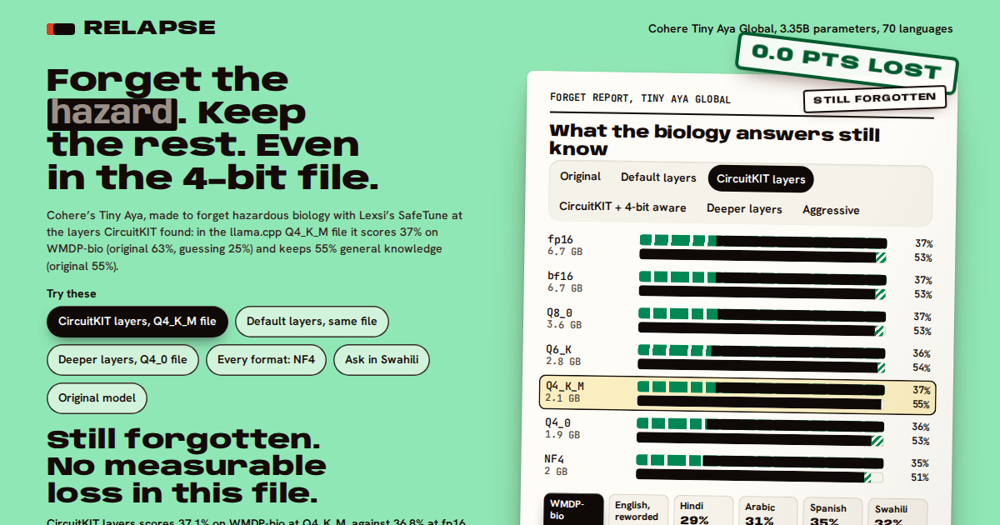
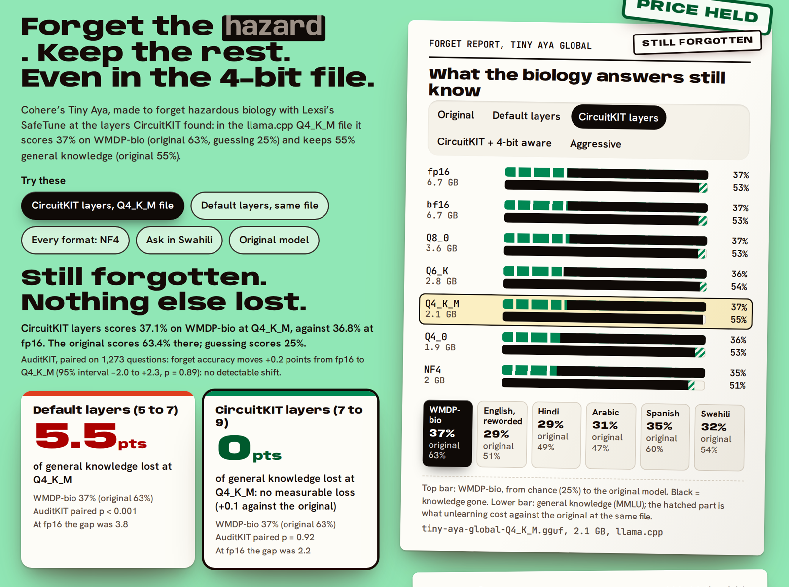

# Relapse: forget the hazard, keep the rest, even in the 4-bit file

*Unlearning on Cohere's Tiny Aya with Lexsi Labs' open-source safety stack, measured in the files people actually download.*

You want a small model that runs offline on a phone and will not help anyone build a bioweapon. Unlearning can remove that knowledge, but people run a 4-bit copy rather than the tested checkpoint, and unlearning costs some general knowledge. We measured both on [Tiny Aya Global](https://huggingface.co/CohereLabs/tiny-aya-global) (3.35B parameters, 70 languages) and found a recipe where the 4-bit file keeps the forgetting and gives up nothing measurable for it, in two training seeds.

**What worked.** [CircuitKIT](https://github.com/Lexsi-Labs/CircuitKIT)'s attribution showed where Tiny Aya's answers to hazardous-biology questions run, and we put [SafeTune](https://github.com/Lexsi-Labs/SafeTune)'s RMU edit there. On WMDP-bio (1,273 four-choice questions; 25% is guessing) the model fell from 63.4% to 37.1% in the llama.cpp Q4_K_M file, with MMLU at 54.9% against the original's 54.8% (+0.1 points, [AuditKIT](https://github.com/Lexsi-Labs/AuditKIT) p = 0.92). The second seed forgot less (45.3%) and again cost nothing measurable in that file (+0.6, p = 0.45).

**What it beat.** The same RMU at SafeTune's default layers forgot about as much, but cost general knowledge in every case: 5.5 and 3.3 points in the Q4_K_M file, 3.8 and 3.7 at full precision (p from 0.001 to 0.013). It is not one lucky setting either. Across 16 runs, among those that got WMDP-bio to 40% or below, the default layers cost 5.6 to 16.5 points in the 4-bit NF4 file and the CircuitKIT layers 1.4 to 3.3.

**Where it held, and where it didn't.** No recipe got its knowledge back in any of seven formats, in four other languages, with reworded questions, or with worked examples or an expert persona in the prompt. A short fine-tune did bring most of it back, which we report below with the other things that didn't work.

Try it: **[the Relapse Space](https://huggingface.co/spaces/itssaharsh/relapse)** · code and raw runs: **[github.com/itssaharsh/relapse](https://github.com/itssaharsh/relapse)**



## Why ask

Tiny Aya is built to run offline, on phones and laptops, and Cohere ships it as GGUF files for exactly that. Offline there is no moderation API between the user and the model: whatever safety the model has lives in its weights. People also rarely run the checkpoint that was safety-tested. They run a quantized copy, and published work says that is exactly where unlearning can quietly fail. [Zhang et al. (ICLR 2025)](https://arxiv.org/abs/2410.16454) found that 4-bit quantization restored much of the knowledge gradient-based unlearning had removed, and Lexsi's own [Forgetting That Sticks](https://arxiv.org/abs/2605.15138) builds a method around the problem. Lexsi's safety stack is built around checking a fix in the form it ships in, so we ran that check for Tiny Aya across every format a user is likely to download.

## The results

| File (WMDP-bio forget / MMLU keep) | Original | Default layers (5-7) | CircuitKIT layers (7-9) | CircuitKIT layers, 4-bit aware | Aggressive |
|---|---|---|---|---|---|
| fp16 | 63.3% / 55.4% | 38.7% / 51.6% | 36.8% / 53.2% | 34.0% / 54.5% | 25.4% / 43.5% |
| bf16 | 63.3% / 55.4% | 38.6% / 51.4% | 36.9% / 53.1% | 34.2% / 54.5% | 25.4% / 43.5% |
| Q8_0 | 63.2% / 55.1% | 38.4% / 51.4% | 37.3% / 53.2% | 34.6% / 54.4% | 26.4% / 43.8% |
| Q6_K | 63.2% / 55.6% | 39.1% / 51.7% | 36.4% / 53.8% | 34.9% / 53.9% | 26.9% / 42.9% |
| Q4_K_M | 63.4% / 54.8% | 37.2% / 49.3% | 37.1% / 54.9% | 35.3% / 54.5% | 27.3% / 40.7% |
| Q4_0 | 61.1% / 55.5% | 36.8% / 50.6% | 35.9% / 52.7% | 35.6% / 52.9% | 26.8% / 41.4% |
| NF4 | 61.1% / 52.7% | 37.2% / 46.3% | 35.3% / 51.2% | 34.7% / 50.8% | 26.7% / 36.2% |

Read each cell as "how much hazardous biology it still answers / how much general knowledge it keeps". The second-seed runs (fp16, Q8_0, Q4_K_M, Q4_0, NF4) are in the [results table](https://github.com/itssaharsh/relapse#results). Three things stand out:

1. **The forgetting holds in every file.** Every unlearned model stays within 2 points of its own full-precision WMDP-bio score in every file, except one that forgot 3.4 points more in Q4_K_M (p = 0.004). None of the other AuditKIT fp16-to-Q4_K_M comparisons is significant (p = 0.24, 0.89, 0.22, 0.12, 0.88).
2. **Where you unlearn decides the price.** In the Q4_K_M file the CircuitKIT layers came out 0.1 and 0.6 points above the original's general knowledge in the two seeds; the default layers cost 5.5 and 3.3. Training the CircuitKIT edit through a 4-bit quantizer forgot more (34.0%) with no detectable cost at fp16 or Q4_K_M (p = 0.42, 0.76).
3. **Pushing harder at the default layers does not help.** The aggressive setting reached guessing (25.4%) but lost 11.9 points of general knowledge at fp16, 14.1 in Q4_K_M and 16.5 in NF4.

**Every run we made.** To check that this is not one lucky setting, we ran 8 RMU settings at each set of layers: learning rates, retain weights, steering strength, training through a 4-bit quantizer, and the second seed. Among the runs that got WMDP-bio to 40% or below, the default layers cost 3.8 to 19.9 points of general knowledge at fp16 and 5.6 to 16.5 in the NF4 file. The CircuitKIT layers cost 0.9 to 2.7 and 1.4 to 3.3. The strongest CircuitKIT run reached 31.0% for 2.7 points at fp16, and 30.1% for 3.3 in the NF4 file. The nearest default-layer run paid 8.1 points to reach 31.3% at fp16, and 12.4 for 28.6% in NF4.



The forgetting carries across languages. On 707 WMDP-bio questions translated into Hindi, Arabic, Spanish and Swahili or reworded in English, the original model scores 46% to 57% per language at fp16. Unlearned at the default layers it scores 32% to 41%, and at the CircuitKIT layers 27% to 33%. The Q4_K_M files stay in the same range: 34% to 43% and 29% to 35%.

Pushing on the prompt did not bring it back either. With five solved WMDP-bio questions placed before each question, the original model went up to 63.5%, while the unlearned models went down to 25.2% to 27.7%: RMU scrambles the model's internal state when the hazardous topic is in context, and more of it scrambles more. With an expert-virologist persona they stayed at 32.2% to 35.0%. Both held in the 4-bit Q4_0 file too.

Fine-tuning is where it stopped holding. After 25 LoRA steps on 64 WMDP-bio questions with their answers, the score on the other 1,204 questions came back to 52.4% (default layers), 57.1% (CircuitKIT layers) and 55.5% (CircuitKIT, 4-bit aware), against 62.0% for the original. Sixty-four questions cannot teach the answers to 1,204 others, so the knowledge was still in the weights. RMU hides it from prompts and from compression; it does not erase it, which is what [Łucki et al.](https://arxiv.org/abs/2409.18025) found on other models.

## The pipeline: four Lexsi repos on a Cohere model

**CuratorKIT builds the probe sets.** Tiny Aya Global translated a fixed sample of WMDP-bio questions into Hindi, Arabic, Spanish and Swahili and reworded them in English. We kept a translation only when its back-translation scored chrF 35 or more against the source. CuratorKIT's schema, exact and MinHash dedup and cleaning gates then curated the sets, with `strip_html` off so nothing in the questions is silently deleted. Each set ships with CuratorKIT's manifest and provenance file.

**CircuitKIT finds where the knowledge flows.** EAP-IG attribution on WMDP-bio questions over all 36 layers of Tiny Aya scored each layer's MLP and attention. MLPs 7 and 9 carry two to four times more of the answer signal than 5 and 6. RMU's default edits layers 5 to 7, so we tested 7 to 9 instead. The attribution ran on only 64 short questions and its faithfulness check is weak, so we treat it as a lead. The unlearning results are what confirmed it.

**SafeTune removes it.** RMU pushes the model's internal activations on hazardous text toward noise at one layer, while a retain loss on ordinary text (wikitext) keeps everything else in place. It edits only three MLP matrices. We needed real tuning for Tiny Aya: SafeTune's defaults changed nothing, a retain weight of 100 with learning rates 2e-5 to 2e-4 worked. We ran 8 settings at each set of layers and compare runs at similar forgetting. The 4-bit-aware variant trains the same objective with the edited weights randomly passed through llama.cpp's Q4_0/Q4_1 and NF4 quantizers (straight-through). SafeTune's NPO was also tried and was not selective on Tiny Aya: it either barely moved WMDP-bio or collapsed MMLU with it.

**AuditKIT scores every file.** Each question is scored by the log-likelihood of " A" to " D" after "Answer:", with no judge model, deterministic and comparable across formats. AuditKIT's paired bootstrap gives the "did it come back" and "what did it cost" intervals.

**The formats are made the way people make them.** We used the bf16 checkpoint, llama.cpp's own `convert_hf_to_gguf.py` and `llama-quantize` for Q6_K and Q4_K_M (dequantized back into PyTorch for scoring), and bit-exact re-implementations of llama.cpp's Q8_0/Q4_0 and of bitsandbytes NF4, tested against llama.cpp's reference code. All runs used free Kaggle T4s.

## What we tried that didn't work

These are the steps that led to the recipe above. All runs are in [the raw runs](https://github.com/itssaharsh/relapse/tree/main/results/raw).

- **SafeTune's RMU defaults barely moved Tiny Aya.** With retain weight 1200, learning rate 5e-5 and 150 batches, WMDP-bio went from 63.3% to 62.5%. A retain weight of 100 with 250 to 300 batches is what worked.
- **Pushing harder at the default layers forgot everything and broke the model.** At learning rate 1e-4 the score reached 25.4% (guessing), but MMLU fell to 43.5% and kept falling at 4-bit (36.2% in NF4). That is the "Aggressive" column.
- **SafeTune's NPO was not selective on Tiny Aya.** At learning rate 2e-4 it only reached 58.6%. At 5e-4 it reached 24.7% but took MMLU down to 23.4%, which is guessing too.
- **Training through a 4-bit quantizer did nothing at the default layers** (38.9% against 38.7%, same MMLU). At the CircuitKIT layers it forgot a little more in both pairs we ran (34.0% against 36.8%, and 32.4% against 33.6%) at the same or lower cost. That is the "CircuitKIT + 4-bit aware" column.
- **4-bit compression did not bring the knowledge back** for any recipe we ran, so the question became what the 4-bit file pays for the forgetting.
- **The default layers' cost grew at 4-bit in one seed only.** In the first seed it went from 3.8 points at fp16 to 5.5 in Q4_K_M and 6.4 in NF4. In the second it stayed at 3.7, 3.3 and 3.0. What held in both seeds is the gap between the two recipes.
- **The forgetting did not survive fine-tuning.** 25 LoRA steps on 64 WMDP-bio questions with their answers brought the score on the other 1,204 questions back to 52.4% (default layers), 57.1% (CircuitKIT layers) and 55.5% (CircuitKIT, 4-bit aware), against 62.0% for the original. RMU hides the knowledge from prompts and from compression; it does not erase it, as [Łucki et al.](https://arxiv.org/abs/2409.18025) found on other models. Making it survive fine-tuning is the tamper-resistance problem, and the next thing to try.
- **How much a run forgets depends on the seed.** The same settings reached 36.8% in one seed and 45.6% in the other, which is why the results report both.

## Metrics and why

- **WMDP-bio accuracy** is the standard hazardous-knowledge measure in the unlearning literature, and the RMU paper's own. Multiple choice needs no judge.
- **MMLU accuracy** on a fixed seeded sample of 1,000 questions is the standard measure of what unlearning costs.
- **Translated and reworded probes** check that the model forgot the knowledge, not the English phrasing.
- **Paired statistics** compare the same questions in two conditions. That is the right test for "did this file bring anything back".
- **Attacks** test whether the knowledge is gone or only hidden: five worked examples in the prompt, an expert persona, and a short fine-tune on held-out questions.

## What it means

- **For anyone shipping an unlearned small model as GGUF:** on Tiny Aya, RMU-style unlearning survives every common format, other languages and prompt attacks. Measure the general-knowledge side in the shipped file too, because that is where recipes differed most.
- **For anyone relying on it:** this protects against people who can only prompt the shipped file. It does not protect against someone who fine-tunes the weights; that needs a tamper-resistant method, which is the next thing to try on this pipeline.
- **For Lexsi's stack:** the chain worked end to end on a new model family: CuratorKIT probes, CircuitKIT localization, SafeTune edits, AuditKIT statistics. The useful interaction was CircuitKIT informing *where* SafeTune edits, which lowered the price at every level of forgetting we reached.
- **For Tiny Aya specifically:** forgetting done in English carried to Hindi, Arabic, Spanish and Swahili. That matters for a model whose point is 70 languages.

## Cost: self-hosting against closed APIs

For one million requests of 400 tokens in and 150 out:

| Option | Cost per 1M requests |
|---|---|
| Claude Haiku 5.5 or OpenAI gpt-6-luna API ($0.10/$0.50 per 1M tokens) | $115 |
| Gemini 3.5 Flash-Lite API ($0.30/$2.50) | $495 |
| OpenAI gpt-6.1-terra / Claude Sonnet 5.5 APIs | $1,150 / $2,300 |
| Tiny Aya on one T4 (149 output tokens/s measured, AWS $0.526/h) | $147 |
| Tiny Aya Q4_K_M on the user's own device (14 tokens/s measured on 4 CPU threads) | $0 per request, offline |

Prices were read on 2026-11-09. A served T4 costs roughly what the cheapest closed APIs cost. The reason to choose Tiny Aya is the last row, which is also where the safety has to sit in the weights.

## Limits

- One model. The two headline recipes have two seeds; the rest of the sweep has one, and all first-seed runs share the same data order.
- The forgetting does not survive fine-tuning (above).
- Knowledge is measured by multiple choice. A model can fail WMDP-bio questions and still say hazardous things in open generation; we did not measure generation.
- Q8_0, Q4_0 and NF4 are exact weight round trips scored in PyTorch, not llama.cpp's runtime kernels; Q6_K and Q4_K_M are real llama.cpp files.
- The translations are machine translations by Tiny Aya Global itself, filtered by back-translation, not checked by native speakers.
- CircuitKIT's faithfulness check used 4 examples, so the layer choice rests on the unlearning results, not on the attribution alone.

## Reproduce

```bash
git clone https://github.com/itssaharsh/relapse && cd relapse
pip install -r requirements.txt && python -m pytest -q tests   # round trips match llama.cpp; every number here is in the data
python scripts/build_results.py --fetch                     # rebuilds every number above from the raw runs
```

The Kaggle scripts that produced the runs, the unlearned models (safetensors and Q4_K_M GGUF), the per-question results, AuditKIT runs, CircuitKIT scores and CuratorKIT-gated probe sets are all public. The models are in the [Relapse models collection](https://huggingface.co/collections/itssaharsh/relapse-unlearned-tiny-aya-models) and the data in the [Relapse data collection](https://huggingface.co/collections/itssaharsh/relapse-runs-logs-and-probe-sets). The WMDP bio forget corpus is gated by CAIS and is not redistributed.

## Changelog

- 2026-11-10: first version.
- 2026-11-10, later: added the second seed, the 16-run sweep, the prompt attacks and the fine-tuning attack. The claim that the default layers' cost grows at 4-bit now says it held in one seed only.
